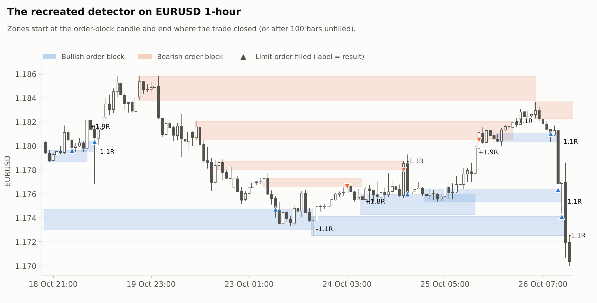
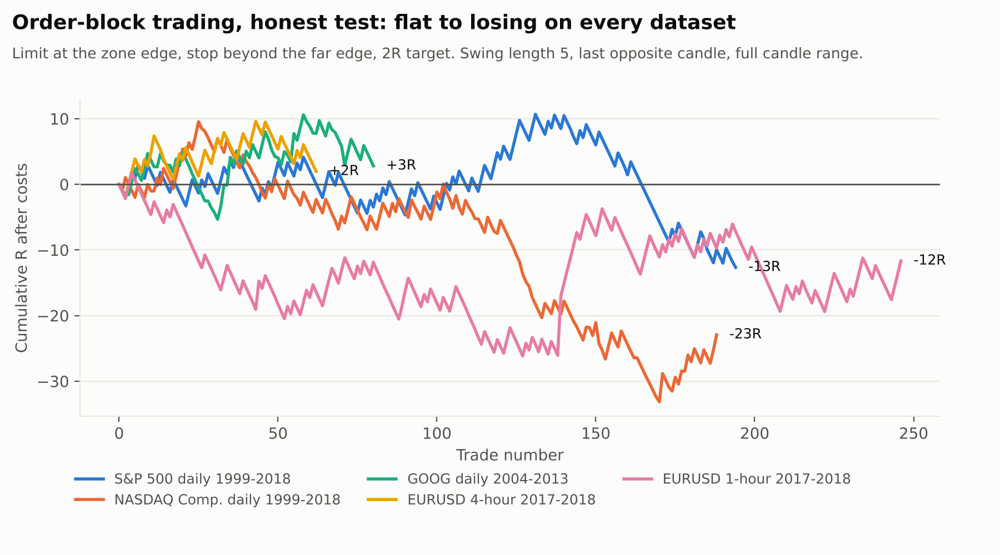
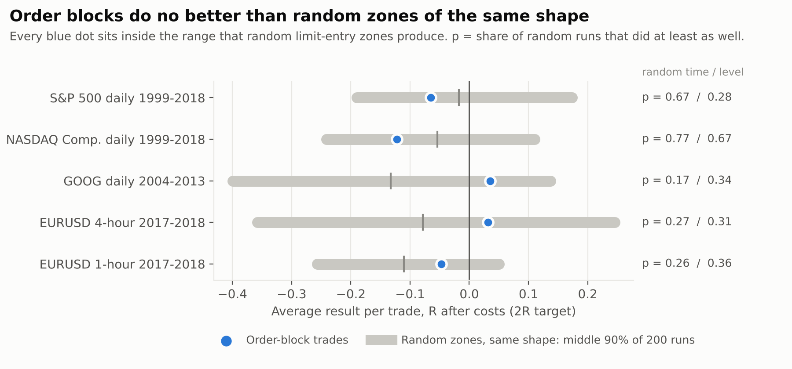
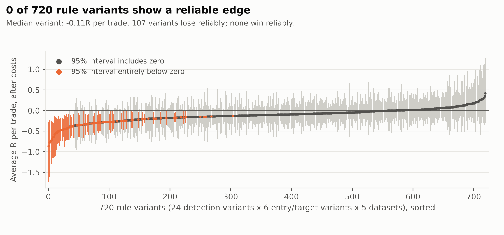
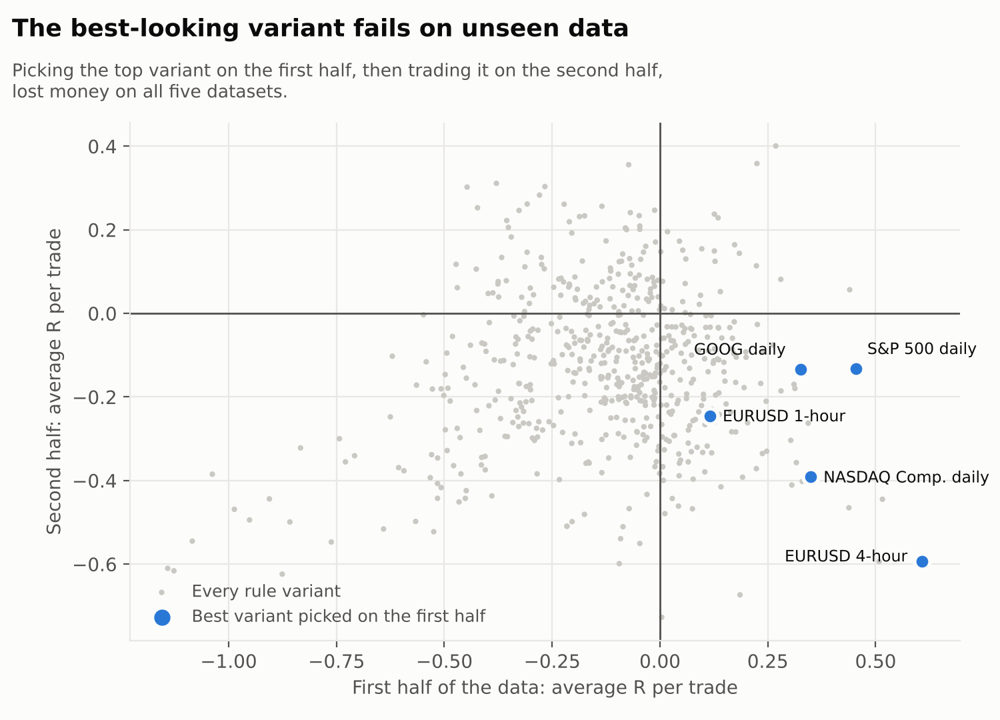
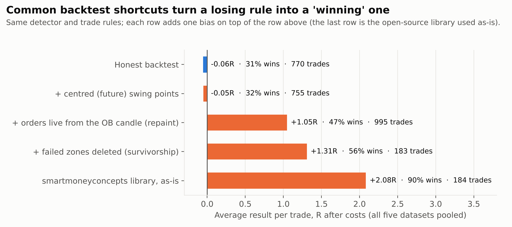

# Order blocks: recreated and tested

**Verdict: the order-block entry is not a trading edge on its own.** In an honest backtest it wins
about as often as a coin flip would need to break even, it does no better than random zones of
the same shape, and none of 720 rule variants shows a reliable profit. The very high win rates
seen in order-block marketing can be reproduced exactly, but only by making two common backtest
mistakes, described in section 5.

## What this does and does not cover

order-block.com could not be opened from this environment: the network policy blocks the host,
and the request to allow it was declined. So this is **not** an audit of that site's specific
rules, claims or track record. It recreates and tests the standard ICT / Smart Money Concepts
order-block method that order-block indicators implement. If you paste the site's rules (or allow
the host), they can be added as one more variant and run through the same tests.

## 1. The strategy, as recreated

Bullish case (bearish is the mirror image):

1. **Swing high**: a bar whose high is the highest of the 5 bars on each side. It is only known
   once those 5 bars to the right have closed.
2. **Break of structure**: a later bar *closes* above the most recent swing high.
3. **Order block**: within the move that made the break, find the lowest low. The order block is the
   last down-close candle at or just before that low (classic ICT wording). A variant uses the
   lowest-low candle itself, which is what most open-source indicators draw.
4. **Zone**: that candle's full range (high to low). A variant uses open to low.
5. **Optional displacement filter**: the move must leave a fair value gap (a 3-candle price gap).
6. **Trade**: buy limit at the top of the zone (variant: its midpoint), stop at the bottom of the zone,
   target at 1R, 2R or 3R. The order is live from the bar after the break, only the first touch
   counts, and an unfilled order is cancelled after 100 bars.

Fill assumptions are conservative: if a bar touches both stop and target, it counts as a loss; on
the fill bar only the stop is checked; gaps fill at the open. Results are in **R** (multiples of
the risk taken) after a round-trip cost: 2 bps for the indices, 5 bps for GOOG, 1 pip for EURUSD.



## 2. Data

All real historical prices, taken from datasets that ship inside Python packages (live downloads
were blocked).

| Dataset | Bars | Period | Price change |
|---|---:|---|---:|
| S&P 500 daily | 5,031 | 1999 to 2018 | +104% |
| NASDAQ Composite daily | 5,031 | 1999 to 2018 | +201% |
| GOOG daily | 2,148 | 2004 to 2013 | +703% |
| EURUSD 4-hour | 1,775 | Jan 2017 to Feb 2018 | +17% |
| EURUSD 1-hour | 6,867 | Jan 2017 to Feb 2018 | +17% |

## 3. Honest backtest

Main setup: 5-bar swings, last opposite candle, full candle range, no gap filter, limit at the
zone edge, 2R target.

| Dataset | Trades | Win rate | Win rate needed to break even | Avg R before costs | Avg R after costs | 95% range (after costs) |
|---|---:|---:|---:|---:|---:|---|
| S&P 500 daily | 194 | 32.0% | 33.3% | -0.05 | -0.07 | -0.25 to +0.13 |
| NASDAQ daily | 188 | 28.2% | 33.3% | -0.11 | -0.12 | -0.33 to +0.10 |
| GOOG daily | 80 | 30.0% | 33.3% | +0.06 | +0.04 | -0.30 to +0.40 |
| EURUSD 4-hour | 62 | 35.5% | 33.3% | +0.07 | +0.03 | -0.32 to +0.39 |
| EURUSD 1-hour | 246 | 32.9% | 33.3% | +0.03 | -0.05 | -0.24 to +0.15 |
| **All pooled** | **770** | **31.4%** | **33.3%** | **-0.02** | **-0.06** | **-0.15 to +0.05** |

At 1R and 3R targets the picture is the same: win rates of 40-50% against 50% needed, and 22-26%
against 25% needed. A pure random walk with these stop and target distances would win 1/(1+R) of
the time, and that is what order blocks deliver. The pooled range rules out an edge bigger than
about +0.05R per trade for this setup.



**Long vs short.** Longs did better than shorts in every dataset: for example, GOOG longs made
+0.27R per trade while shorts lost 0.26R, and EURUSD 1-hour longs made +0.16R while shorts lost
0.29R. Every dataset went up over its period, so this is the market's trend showing through, not
the zone. The random-zone test below keeps the same long/short mix and still finds no edge.

## 4. Is the zone special? Three tests

**Random zones.** For each real order block, a fake zone with the same width and distance from
price was placed (a) at a random bar, or (b) at the same bar but a random depth. Both were traded
with identical rules, 200 times each. Real order blocks never beat the random zones by a
meaningful margin. The smallest p-value is 0.17, where significance would need about 0.05 or less.



**720 variants.** 3 swing lengths x 2 order-block rules x 2 zone definitions x gap filter on/off
x 2 entry points x 3 targets, on all five datasets. **0 of 720** have a 95% range above zero;
**107** are reliably negative. The median variant loses 0.11R per trade. Even random chance should
leave a handful of false winners, and costs push the whole distribution below zero.



**Pick on one half, test on the other.** Choosing the best variant on the first half of each
dataset, as a trader tuning settings would, and then trading it on the second half lost money
in all five cases (+0.12 to +0.61R in-sample, then -0.13 to -0.59R out-of-sample). Only 0-11% of
variants were profitable in both halves. Rankings carried over somewhat for GOOG (rank correlation
0.65) but not elsewhere (-0.37 to +0.17), and even GOOG's best pick lost money out-of-sample.



## 5. Why order-block tools look so good anyway

Starting from the honest result, one shortcut is added per row:



* **Centred swing points** (using a swing high as soon as it happens) change almost nothing
  (-0.06R to -0.05R). A break can't happen while a swing point is still being confirmed, so this
  leak is small.
* **Orders live from the order-block candle** turn -0.06R into **+1.05R per trade**. The zone
  doesn't exist until the break-of-structure bar closes, but indicators draw it at the earlier
  candle. A backtest that trades from there gets filled during the very move that later proves the
  zone "worked". This is the repainting trap: on a chart, every zone appears to launch price.
* **Deleting zones that failed** (traded through, then reclaimed) leaves only 183 of 995 trades
  and lifts the win rate to 56%. Indicators that remove broken zones show you the survivors.
* The open-source `smartmoneyconcepts` library does both things by design (its zones are indexed
  at the order-block candle and broken zones are erased). Backtested as-is with the same 2R
  rules, it reports **90% wins and +2.08R per trade**, from a method that honestly loses money.
  That's fine for drawing a chart. It is a trap for backtesting.

These two effects are the likely source of the 70-90% win rates often quoted for order-block
indicators and courses. When you evaluate any such product, check: does the zone appear on the chart
at the order-block candle or at the breaking bar? Do broken zones disappear? Are results from
time-stamped live signals, or from a historical chart?

## 6. Conclusion

* As a mechanical entry signal, order blocks have **no measurable edge** on 20 years of index data,
  10 years of a single stock or a year of EURUSD. After costs they lose slightly.
* Settings tuned in hindsight don't carry forward.
* Order blocks can still be a useful *language* for placing stops and limits, because they give a
  defined risk point. Any profit would have to come from something else: trend direction,
  position sizing, or a filter that has been tested separately.

**Limits of this study.** It doesn't cover crypto, intraday futures or other FX pairs, and only one
year of EURUSD was available. It doesn't test discretionary add-ons such as session times,
higher-timeframe bias or liquidity sweeps. Trades can overlap in time, so the confidence ranges
are slightly too narrow, which makes the "no edge" finding more conservative, not less. The
TradingView script in `pine/` runs the same rules on any symbol, so you can check other markets
yourself.

## Reproduce

```bash
pip install -r requirements.txt
python -m pytest tests          # 11 unit tests on hand-built candles
python run_analysis.py          # ~20 s; writes results/ (CSV, JSON, charts)
```
